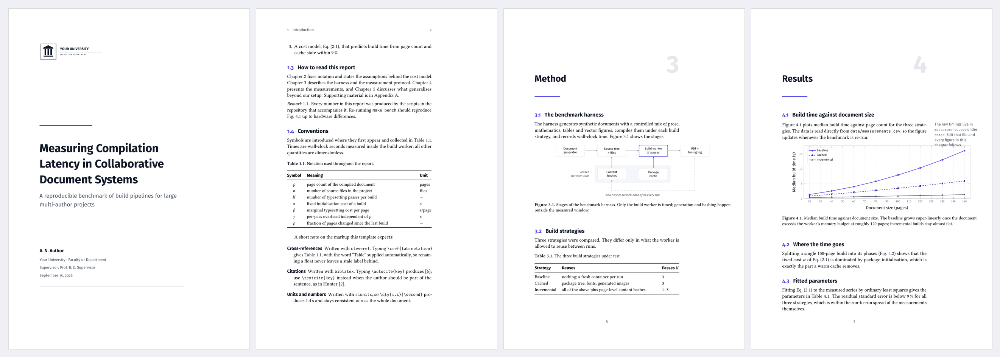

# Academic Report Template

A modern, fast-compiling LaTeX template for theses, project reports and
technical reports. Built for pdfLaTeX, so a full rebuild of the 14-page
example takes about three seconds.

[](https://app.inscrive.io/docs?snip_uri=https%3A%2F%2Fgithub.com%2Finscrive-io%2Flatex-report-template%2Farchive%2Frefs%2Fheads%2Fmain.zip&snip_name=Academic%20Report&main_document=main.tex&engine=pdflatex)



## What you get

- **A cover page driven by metadata.** Set the title, author, institution
  and logo in `main.tex`; the cover lays itself out.
- **A placeholder institution logo** at `figures/logo-placeholder.pdf`.
  Drop your own PDF, PNG or JPG in its place and nothing else changes.
- **One place for design decisions.** All styling lives in
  `style/universityreport.sty`. The six brand colours are the first thing
  in the file.
- **Figures that read your data.** The charts are drawn with `pgfplots`
  straight from `data/measurements.csv`, so re-running an experiment
  updates the report.
- **A measure you can read for an hour.** The text block is set to about
  72 characters per line at 12 pt. The space that buys goes into a wide
  outer margin you can actually use: `\sidenote{...}` puts a remark
  there, and the `widefigure` environment lets a figure spill into it.
- **Matching maths.** Body text is Libertinus Serif and so are the
  equations, via `libertinust1math`. No Computer Modern anywhere.
- **Diagrams in TikZ**, theorem and definition environments, callout
  boxes, `booktabs` tables with `siunitx` number alignment, and syntax
  highlighted code listings.
- **References with `biblatex` and `biber`**, plus `cleveref` so
  `\cref{fig:latency}` typesets as "Figure 4.1" without you writing the
  word.
- **Three matching callouts**: `keybox`, `examplebox` and `alertbox`.
  The presentation template styles its blocks identically, so a deck and
  its report look like one family.

## Layout

```
main.tex                  metadata and document order, nothing else
style/universityreport.sty all design: colours, fonts, headings, boxes
content/                  one file per chapter
  00-abstract.tex
  01-introduction.tex
  02-background.tex
  03-method.tex
  04-results.tex
  05-conclusion.tex
  appendix-a.tex
data/measurements.csv     data the figures read at compile time
figures/                  logo placeholder and any images you add
references.bib            bibliography
```

## Two decisions worth knowing about

**Colour is structural.** The accent appears on rules, section numbers
and the ghost chapter numerals, and almost nowhere in running text.
Internal cross-references are set in black, because a page speckled with
coloured references is tiring to read and collapses to grey when
printed. Only genuine external links carry colour. If you would rather
have clickable-looking cross-references, change `linkcolor` in section 11
of `style/universityreport.sty`.

**Accessibility.** The PDF carries its title, author and language in the
document properties, and letterspaced text is tagged so it copies back
as words rather than as spaced-out letters. Full structural tagging
(`\DocumentMetadata{... testphase=phase-III}`) is not enabled here,
because it currently conflicts with `cleveref`. The CV template in the
same series does ship it as a tested option.

## Making it yours

1. Replace `figures/logo-placeholder.pdf` with your institution logo.
   Keep the filename, or point `\reportlogo{...}` in `main.tex` at a new
   one.
2. Open `style/universityreport.sty` and change `accent`, `accentdark`
   and `ink` in section 1 to your institution's colours.
3. Fill in the metadata block in `main.tex`.
4. Write in `content/`. Add a chapter by creating a file and adding one
   `\input{}` line.

## Building it locally

```bash
latexmk -pdf main.tex
```

Engine: **pdfLaTeX**. Bibliography: **biber**. Both are the defaults in
Inscrive, so the button above needs no configuration.

## Licence

[MIT](LICENSE). Use it, change it, ship it.
